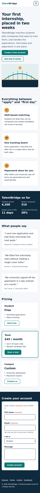
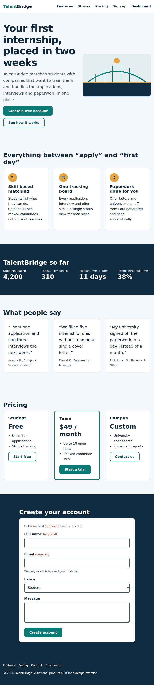
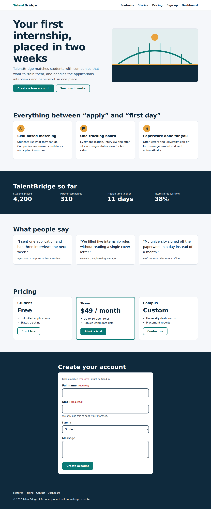
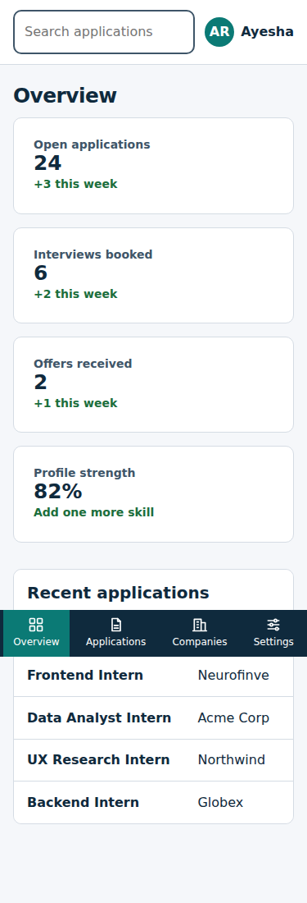
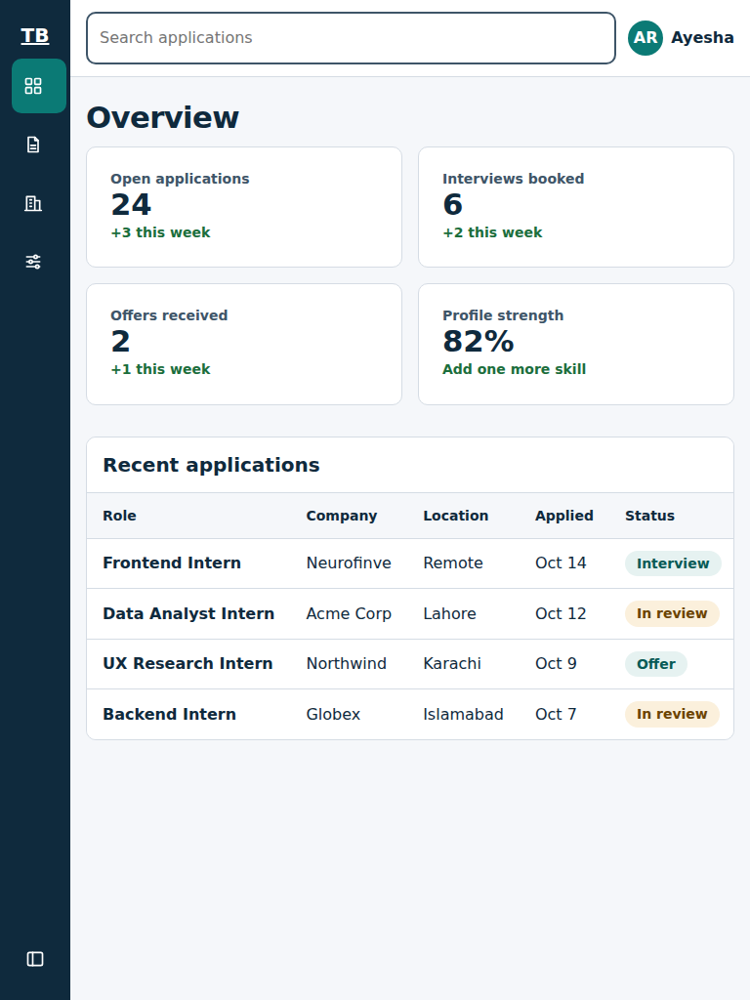
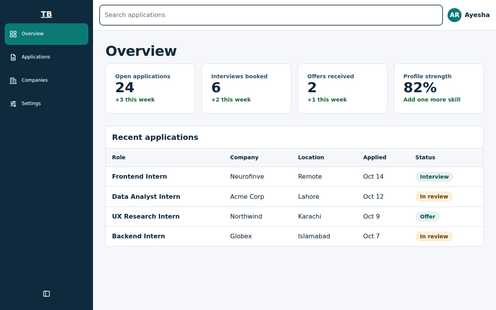

# TalentBridge: Responsive Marketing Page and Dashboard Shell

Static HTML5 + CSS3 interface for a fictional internship-placement product. No framework, no JavaScript.

- `landing.html`: header with mobile hamburger, hero, features, stats, testimonials, pricing, signup form, footer
- `dashboard.html`: collapsible sidebar (bottom nav on mobile), top bar with search and user menu, 4 stat cards, scrollable table
- `styles.css`: one shared, documented stylesheet

## Run it
Open `landing.html` in a browser, or run `npx serve .` in this folder.

## Screenshots
| | Mobile (375px) | Tablet (768px) | Desktop (1280px) |
|---|---|---|---|
| Landing |  |  |  |
| Dashboard |  |  |  |

## CSS architecture decisions
1. **Design tokens in `:root`**: colors, a 4px-based spacing scale (`--s-1`..`--s-8`) and a fluid font scale (`--f-sm`..`--f-xl`) are CSS variables, so values are reused, never hard-coded.
2. **BEM naming** (`.card`, `.field__input`, `.sidebar__link`) keeps specificity flat and avoids collisions.
3. **Mobile-first**: base styles target phones; `min-width` queries at 768px (tablet) and 1024px (desktop) add layout, with fluid `clamp()` type in between.
4. **Flexbox for 1D, Grid for 2D**: nav and button rows use Flexbox; feature, pricing, stat and app-shell layouts use Grid.
5. **No-JS interactivity**: hamburger and sidebar collapse use a visually hidden checkbox plus `:checked`; the user menu uses `
`; validation states use `:user-invalid` / `:user-valid`.
6. **Accessibility built in**: skip links, visible `:focus-visible` rings, 44px touch targets, labelled inputs, text (not just color) for errors and required fields, a keyboard-focusable table scroll region.

## Layout decisions borrowed from real SaaS dashboards
- **Linear**: a collapsible icon-only sidebar, to give the content more room.
- **Vercel**: a plain top bar with global search and a user menu, so search is always reachable.
- **Notion**: wide tables sit in a scroll container instead of reflowing, so columns stay readable on phones.

## Responsive images
The hero uses `<picture>` with WebP and JPEG fallbacks, `srcset` at 480/800/1280px widths, a `sizes` hint (`48vw` on tablet and up, `100vw` on mobile) and explicit `width`/`height` to prevent layout shift (per MDN's responsive images guide).

## Testing done
- No horizontal scroll at 320, 375, 480, 768, 1024, 1280 and 1920px
- axe-core accessibility audit: 0 violations on both pages (mobile and desktop)
- Keyboard: hamburger opens with Space; sidebar collapse is reachable by Tab
- Run Lighthouse in Chrome DevTools yourself and note the scores here (target: Accessibility 90+)
